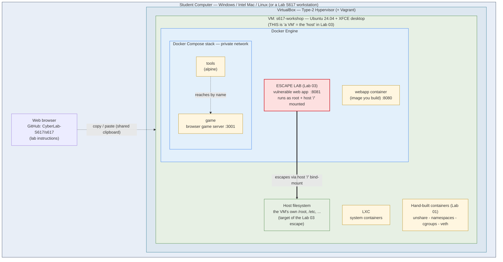
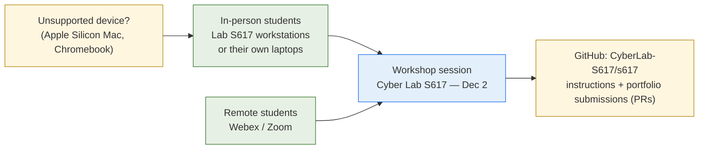

# Workshop Topology

How the workshop fits together. The key idea students should take away is the
**nesting**: a VM runs inside VirtualBox on their computer, and containers run
inside that VM. **A VirtualBox window = a VM; a shell with a different prompt
inside it = a container.**

## Technical stack (what each student runs)

**Reading it from the outside in:**

- **Student Computer** — their own laptop (Windows / Intel Mac / Linux) or a Lab
  S617 workstation. A browser shows the lab instructions from GitHub.
- **VirtualBox (+ Vagrant)** — the Type-2 hypervisor. `vagrant up` builds the VM
  from a recipe. The shared clipboard lets students paste commands from the
  GitHub page into the VM.
- **VM `s617-workshop`** — Ubuntu 24.04 with an XFCE desktop. *This* is the
  virtual machine (its own kernel, own desktop).
- **Inside the VM:**
  - **Docker Engine** runs the **webapp** container (the image students build)
    and the **Compose stack** — a browser game server plus a `tools` container
    that reaches it by name over Docker's private network.
  - **LXC** for system containers.
  - **Hand-built containers** from Lab 01 (namespaces, cgroups, veth) — the same
    isolation Docker automates, built by hand.
  - **The Escape Lab (Lab 03)** — a deliberately misconfigured container (runs as
    root, with the host `/` bind-mounted). The red arrow shows it breaking out of
    the Docker boundary to write to the **host filesystem** — a container escape,
    performed and then fixed, all inside the student's own disposable VM.

## Delivery (hybrid — Dec 2)

A rendered image of the technical stack is in **`topology.png`** (and
`topology.svg`) for use in slides or the flyer.
